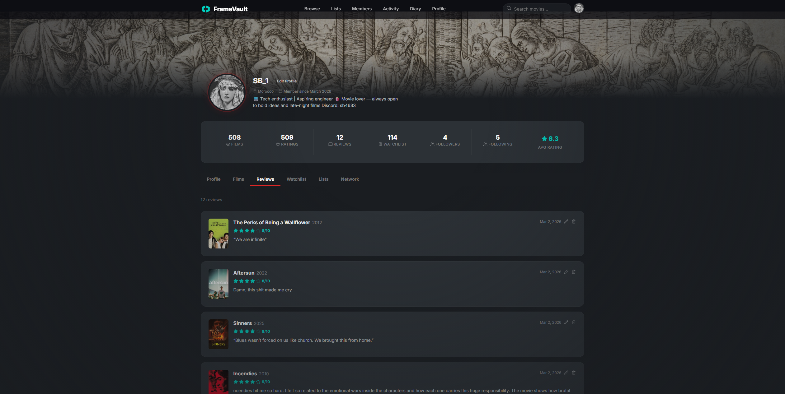
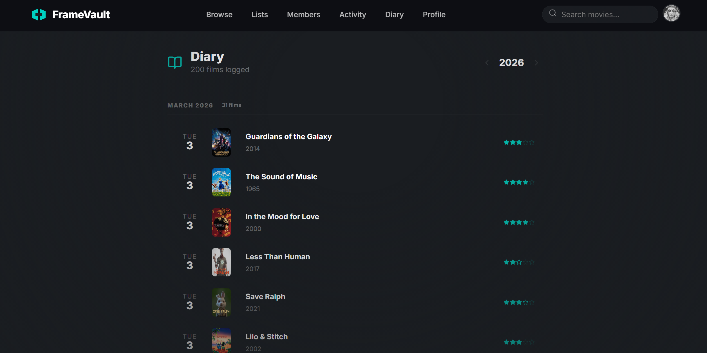
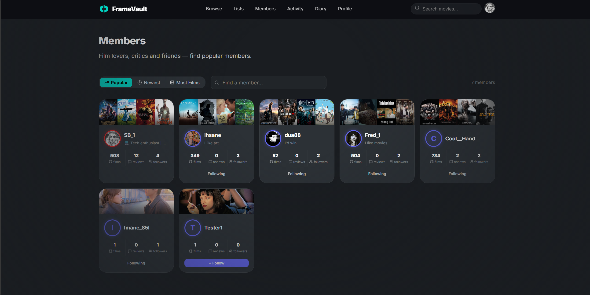

<div align="center">


# FrameVault

### A social film-tracking platform — discover, rate, review, and share every movie you watch.

[](https://frame-vault-xi.vercel.app)
[](https://nextjs.org)
[](https://www.typescriptlang.org)
[](https://www.prisma.io)
[](https://supabase.com)

</div>

---

## 📸 Screenshots

<table>
  <tr>
    <td align="center" width="50%">
      
      <br/><sub><b>Movie Detail</b> — hero backdrop, ratings, cast, reviews, trailer</sub>
    </td>
    <td align="center" width="50%">
      
      <br/><sub><b>Home Page</b> — Popular Right Now + Picked For You recommendations</sub>
    </td>
  </tr>
  <tr>
    <td align="center" width="50%">
      
      <br/><sub><b>Trending This Week</b> and <b>And the Oscar Goes to…</b> sections</sub>
    </td>
    <td align="center" width="50%">
      
      <br/><sub><b>Profile</b> — Top 5 Favorites + Ratings Histogram</sub>
    </td>
  </tr>
  <tr>
    <td align="center" width="50%">
      
      <br/><sub><b>Films Tab</b> — full watched history with sort & rating filters</sub>
    </td>
    <td align="center" width="50%">
      
      <br/><sub><b>Reviews Tab</b> — all written reviews with ratings</sub>
    </td>
  </tr>
  <tr>
    <td align="center" width="50%">
      
      <br/><sub><b>Diary</b> — chronological film log by year and month</sub>
    </td>
    <td align="center" width="50%">
      
      <br/><sub><b>Activity Feed</b> — what people you follow are watching</sub>
    </td>
  </tr>
  <tr>
    <td align="center" colspan="2">
      
      <br/><sub><b>Members</b> — discover film lovers, filter by popular · newest · most films</sub>
    </td>
  </tr>
</table>

---

## ✨ Features

### 🎬 Discovery & Browsing
- **Hero Carousel** — rotating backdrop showcase of trending films with a live rating badge
- **Personalized "Picked For You"** — genre-weighted recommendations derived from your highest-rated movies; updates automatically as you rate more films
- **Trending This Week** — live TMDB trending data refreshed on every request
- **And the Oscar Goes to…** — randomly sampled from TMDB's all-time highest-rated films
- **Popular Right Now** — live client-side carousel that rotates every 30 seconds
- **Browse & Filter** — discover by genre, decade, and sort order; all filters are persisted in the URL so the browser back button always restores your exact position
- **Actor Pages** — click any cast member to see their full filmography with biography, birth info, and movie grid

### 🛡️ Family-Friendly Filtering
- Multi-layer adult content filter applied to every TMDB endpoint (trending, popular, discover, similar, actor credits)
- Primary layer: TMDB's own `adult` flag
- Secondary layer: whole-word keyword matching (40+ terms) + multi-word phrase blocklist checked against title and overview
- Minimum vote-count thresholds to suppress obscure content

### 👤 User Profiles
- **Top 5 Favorites** — pin your all-time favourites; displayed prominently on your profile
- **Custom Posters (Letterboxd-style)** — upload your own poster or pick from TMDB alternatives; custom posters propagate everywhere: profile, watchlist, activity feed, and favorites
- **Films Tab** — paginated watched history with sort options (Latest, Oldest, Top Rated, A–Z) and rating filters (10★ down to 5★+)
- **Reviews Tab** — all your written reviews with inline rating, poster, and edit/delete controls
- **Watchlist Tab** — movies saved to watch later
- **Lists Tab** — curated public or private film lists
- **Network Tab** — followers and following with quick follow/unfollow
- **Ratings Histogram** — visual distribution of all your ratings
- **Stats Bar** — films · ratings · reviews · watchlist · followers · following · avg rating

### 📓 Diary
- Chronological film log grouped by year and month
- Navigate between years with prev/next arrows
- Star rating displayed per entry

### 🎭 Social
- **Follow users** — personalised activity feed and home page recommendations
- **Activity Feed** — real-time stream of watches, ratings, and reviews from people you follow
- **Members Page** — discover members sorted by popular · newest · most films; search by username
- **Friends Activity** on each movie page — see which friends watched it and what they rated it

### ⭐ Rating System
- Rate movies 1–10 (displayed as 0.5–5 stars)
- "Mark as watched?" prompt appears after rating an unwatched film
- Auto-removes a movie from your watchlist when marked as watched
- Per-movie rating histogram visible on every film page
- Friends' ratings overlay on movie detail pages

### 📋 Lists
- Create public or private curated film lists
- Add per-film notes and reorder entries
- Community lists showcased on the home page

### 📤 Import / Export
- **Letterboxd CSV import** — import your full Letterboxd history (watched, ratings, reviews, watchlist) in one go
- **Data export** — export your FrameVault data at any time from Settings

---

## 🛠️ Tech Stack

| Layer | Technology |
|---|---|
| **Framework** | [Next.js](https://nextjs.org) App Router · React 19 · TypeScript |
| **Database** | PostgreSQL via [Supabase](https://supabase.com) |
| **ORM** | [Prisma](https://www.prisma.io) |
| **Auth** | [NextAuth.js v5](https://authjs.dev) — credentials + OAuth |
| **Storage** | Supabase Storage (S3-compatible) for custom poster uploads |
| **Movie Data** | [TMDB API](https://www.themoviedb.org/documentation/api) |
| **Icons** | [Lucide React](https://lucide.dev) |
| **Deployment** | [Vercel](https://vercel.com) — auto-deploy on push to `main` |

---

## 🚀 Getting Started

### Prerequisites
- Node.js 18+
- A PostgreSQL database — free tier on [Supabase](https://supabase.com) works great
- A free [TMDB API key](https://www.themoviedb.org/settings/api)

### 1. Clone & install

```bash
git clone https://github.com/SPIN0ZAi/FrameVault.git
cd FrameVault
npm install
```

### 2. Environment variables

Create a `.env` file in the project root:

```env
# Database
DATABASE_URL="postgresql://..."

# NextAuth
NEXTAUTH_SECRET="your-secret-here"
NEXTAUTH_URL="http://localhost:3000"

# TMDB — use the Bearer token (not the v3 API key)
TMDB_API_KEY="eyJhbGciOiJIUzI1NiJ9..."

# Supabase Storage (for custom poster uploads)
NEXT_PUBLIC_SUPABASE_URL="https://your-project.supabase.co"
NEXT_PUBLIC_SUPABASE_ANON_KEY="your-anon-key"
SUPABASE_SERVICE_ROLE_KEY="your-service-role-key"
```

### 3. Database setup

```bash
npx prisma migrate dev
npx prisma db seed   # seeds the genre list
```

### 4. Run locally

```bash
npm run dev
```

Open [http://localhost:3000](http://localhost:3000).

---

## 📁 Project Structure

```
src/
├── app/
│   ├── page.tsx                  # Home page
│   ├── movies/
│   │   ├── page.tsx              # Browse / discover
│   │   └── [id]/page.tsx         # Movie detail
│   ├── actors/[id]/page.tsx      # Actor filmography
│   ├── users/[username]/page.tsx # User profile
│   ├── diary/page.tsx            # Film diary
│   ├── activity/page.tsx         # Activity feed
│   ├── members/page.tsx          # Members directory
│   ├── lists/                    # Lists pages
│   ├── settings/page.tsx         # Account settings
│   └── api/
│       ├── movies/               # Movie CRUD · ratings · reviews · watched
│       ├── actors/[id]/          # Actor details + filmography
│       ├── users/                # Profiles · follow · watchlist · favorites
│       ├── recommendations/      # Genre-based personalized recs
│       ├── activity/             # Activity feed
│       ├── genres/               # Genre list
│       └── auth/                 # NextAuth routes
├── components/
│   ├── layout/                   # Header · Footer
│   ├── providers/                # NextAuth + SWR providers
│   └── ui/
│       ├── HeroCarousel.tsx      # Home page hero
│       ├── PopularSection.tsx    # Live "Popular Right Now"
│       ├── PersonalizedRecs.tsx  # "Picked For You"
│       ├── ScrollRow.tsx         # Horizontal scroll container
│       └── ImageUploader.tsx     # Custom poster uploader
├── lib/
│   ├── tmdb.ts                   # TMDB API client + adult content filter
│   ├── prisma.ts                 # Prisma client singleton
│   ├── auth/                     # NextAuth configuration
│   └── sync-movie.ts             # TMDB → local DB sync utility
└── types/
    └── next-auth.d.ts            # Session type augmentation
prisma/
├── schema.prisma                 # Database schema
├── seed.ts                       # Genre seed data
└── migrations/                   # Migration history
```

---

## 🌐 Deployment

The app auto-deploys to **Vercel** on every push to `main`.

```bash
npm run build   # production build (also runs prisma generate)
```

Set all environment variables in the Vercel project dashboard under **Settings → Environment Variables**.

---

## 📄 License

MIT — free to use, modify, and distribute.

---

<div align="center">
  <sub>Built with ❤️ by <a href="https://github.com/SPIN0ZAi">SPIN0ZAi</a> &nbsp;·&nbsp; Powered by <a href="https://www.themoviedb.org">TMDB</a></sub>
</div>
