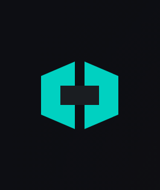
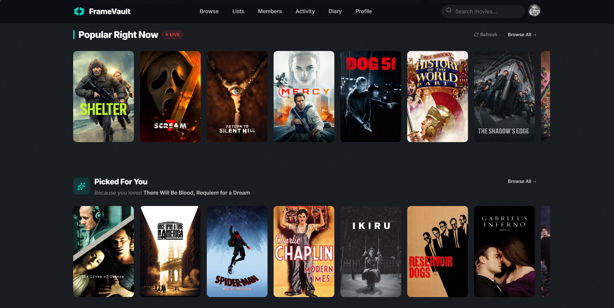
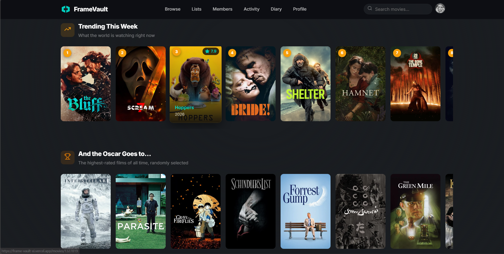
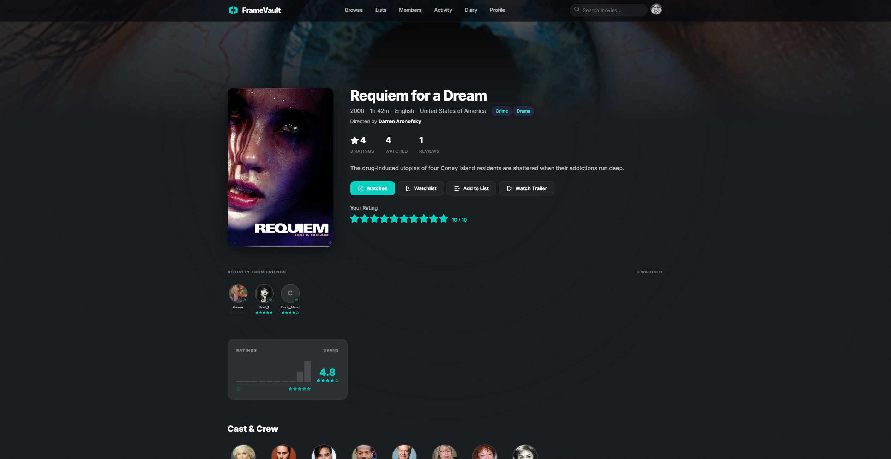
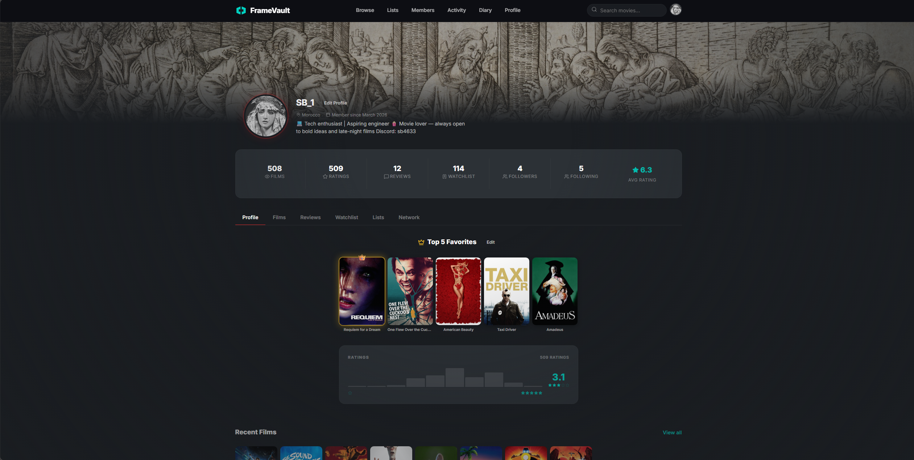
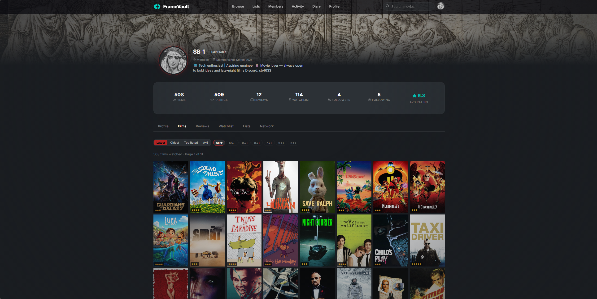

<div align="center">



<h1>FrameVault</h1>

<p><strong>A social film-tracking platform — discover, rate, review, and share every movie you watch.</strong></p>

[](https://frame-vault-xi.vercel.app)
&nbsp;
[](https://nextjs.org)
&nbsp;
[](https://www.typescriptlang.org)
&nbsp;
[](https://www.prisma.io)
&nbsp;
[](https://supabase.com)

</div>

---

## 📸 Screenshots

<table>
  <tr>
    <td colspan="2" align="center">
      
      <br/><sub><b>Home Page</b> — rotating hero carousel with live ratings, Popular Right Now, and personalized recommendations</sub>
    </td>
  </tr>
  <tr>
    <td align="center" width="50%">
      
      <br/><sub><b>Popular Right Now</b> live carousel &amp; <b>Picked For You</b> genre-based recs</sub>
    </td>
    <td align="center" width="50%">
      
      <br/><sub><b>Trending This Week</b> &amp; <b>And the Oscar Goes to…</b> sections</sub>
    </td>
  </tr>
  <tr>
    <td align="center" width="50%">
      
      <br/><sub><b>Movie Detail</b> — hero backdrop, cast, trailer, ratings histogram, reviews</sub>
    </td>
    <td align="center" width="50%">
      
      <br/><sub><b>Profile</b> — Top 5 Favorites, ratings histogram, stats bar</sub>
    </td>
  </tr>
  <tr>
    <td align="center" width="50%">
      
      <br/><sub><b>Films Tab</b> — paginated watch history with sort &amp; rating filters</sub>
    </td>
    <td align="center" width="50%">
      
      <br/><sub><b>Reviews Tab</b> — all written reviews with poster, rating &amp; edit controls</sub>
    </td>
  </tr>
  <tr>
    <td align="center" width="50%">
      
      <br/><sub><b>Diary</b> — chronological film log grouped by month &amp; year</sub>
    </td>
    <td align="center" width="50%">
      
      <br/><sub><b>Activity Feed</b> — real-time stream of watches, ratings &amp; reviews from friends</sub>
    </td>
  </tr>
  <tr>
    <td colspan="2" align="center">
      
      <br/><sub><b>Members</b> — discover film lovers sorted by popular · newest · most films</sub>
    </td>
  </tr>
</table>

---

## ✨ Features

<details open>
<summary><b>🎨 Immersive Themes & Cinematic Atmosphere Engine</b></summary>

- **Dynamic Movie Atmosphere Adaptation** — Opening any movie or TV show detail page automatically transforms the entire platform's visual identity, lighting, and ambient particle effects to match the film's genre, mood, and cinematic world:
  - 🩸 **Slasher & 80s Splatter Horror** (*Scream*, *Friday the 13th*, *Halloween*, *Saw*) ➔ **Bloodbath: 1984** (dripping arterial blood SVG logo, crimson slash accents, horror mist)
  - 🦇 **Vampires & Gothic Horror** (*Nosferatu*, *Dracula*, *Blade*, *Twilight*) ➔ **Nosferatu’s Crypt** (gargoyle bat wings logo, cathedral stone surfaces, night bats swarming in fog)
  - 👾 **Deep Space Sci-Fi Horror** (*Alien*, *Aliens*, *The Thing*, *Predator*) ➔ **Nostromo LV-426** (Weyland-Yutani phosphor CRT motion tracker radar with sweeping beam)
  - 🪓 **Hotel Isolation & Psychological Horror** (*The Shining*, *Misery*) ➔ **Room 237: Overlook** (Overlook Hotel hexagonal carpet maze geometry, alpine blizzard snow)
  - 🐙 **Cosmic Dread & Lovecraftian Horror** (*Cthulhu*, *The Mist*, *Annihilation*) ➔ **Eldritch Abyss** (deep-sea bioluminescent teal, cyclopean pupil wrapped in tendrils)
  - 🍂 **Autumn & Cozy Film Vibes** ➔ **Autumn Harvest** (amber foliage, tumbling golden leaves)
  - ❄️ **Christmas & Holiday Films** ➔ **Winter Wonderland** (frosted pines, warm candlelight, falling snow)
  - 🚀 **Sci-Fi, Cyberpunk, Fantasy, Romance, Action, Noir, Animation, Documentary, Drama** ➔ Custom matched to their respective cinematic worlds
  - *Smooth Restoral:* Leaving the movie/show page immediately restores your site-wide seasonal or pinned theme.
- **Auto Seasonal Calendar** — By default, the general platform (Home, Lists, Members, Explore) automatically follows real-world seasons:
  - **November**: 🍂 Autumn Harvest (warm autumn colors, falling golden leaves)
  - **December & January**: 🎄 Winter Wonderland (cozy winter atmosphere, falling snow)
  - **October**: 🎃 Spooky All Hallows (graveyard fog, glowing pumpkin eyes)
  - **February**: 🌹 Moonlit Velvet (Valentine romantic velvet & petals)
- **18 Handcrafted Unique Visual Themes** — Complete visual overhauls (not just recoloring) featuring bespoke color palettes, tailored typography, custom shadows, borders, and animations:
  - *Seasonal*: Winter Wonderland, Spooky All Hallows, Autumn Harvest
  - *Film Genres*: Galactic Horizon (Sci-Fi), Neo Shinjuku 2099 (Cyberpunk), Arcane Realms (Fantasy), Fury Protocol (Action), Moonlit Velvet (Romance), Midnight Noir (Mystery), Terra Incognita (Adventure), Toon Pop (Animation), 35mm Reel Archive (Documentary), Cinéma d'Auteur (Drama)
  - *Horror Cinema*: Bloodbath: 1984, Room 237: Overlook, Nostromo LV-426, Nosferatu’s Crypt, Eldritch Abyss
- **Authentic Custom Vector SVG Iconography** — Bespoke, handcrafted vector emblems for all 18 themes (no generic phone emojis).
- **Dynamic Morphing Vault Logo** — Custom SVG vault logo that morphs theme-specific vector details (dripping blood drops, Santa hat, bat wings, CRT telemetry, etc.).
- **60fps Ambient Particle Canvas Engine** — Ultra-lightweight HTML5 canvas engine (<1% CPU/GPU overhead) rendering falling snow, autumn foliage, rising embers, floating rose petals, radar sweeps, and swarming bats. Automatically pauses on tab blur (`visibilitychange`) and respects `prefers-reduced-motion`.
- **User Customization in Settings (`/settings`)** — Full control under Appearance tab:
  - Toggle between **Auto Seasonal Mode** and **Pinned Custom Theme** (lock your favorite like `Bloodbath: 1984` permanently everywhere)
  - Toggle **Dynamic Movie Atmosphere** (ON/OFF)
  - Toggle **Ambient Particle Engine** (ON/OFF)
  - 1-click **Interactive Theme Gallery** with live color swatches and instant application

</details>

<details open>
<summary><b>🎬 Discovery & Browsing</b></summary>

- **Smart Global Search Autocomplete** — debounced live suggestions with fuzzy matching; results include movies, TV shows, actors, and community lists; mix of TMDB & local data
- **Hero Carousel** — rotating backdrop showcase of trending films with live TMDB ratings
- **Personalized "Picked For You"** — genre-weighted recommendations built from your highest-rated movies; automatically improves as you rate more films
- **Trending This Week** — live TMDB trending feed, refreshed on every request
- **And the Oscar Goes to…** — randomly sampled from TMDB's all-time top-rated films
- **Popular Right Now** — client-side live carousel that rotates every 30 seconds with a manual refresh button
- **Top 250 Films & Top 250 Series** — official ranked lists of highest-rated movies & TV shows on TMDB; accessible from the Lists page
- **Browse & Filter** — discover by genre, decade, and sort order; all filters sync to the URL so the browser back button always restores your exact page/position
- **Actor Pages** — click any cast member to view their full biography, birth info, and filmography grid

</details>

<details open>
<summary><b>👤 User Profiles</b></summary>

- **Top 5 Favorites** — pin your all-time favourites; prominently displayed on your profile
- **Top 5 Series** — pin your all-time favourite TV shows separately on your profile
- **Custom Posters (Letterboxd-style)** — upload your own poster or pick from TMDB alternatives for both movies and TV shows; propagates everywhere: profile, watchlist, activity feed, and favorites
- **Drag-to-reposition Banner & Avatar** — drag your banner and avatar images to crop exactly how you want; position is saved per-user
- **Films Tab** — paginated watched history (50 per page) with sort options (Latest · Oldest · Top Rated · A–Z) and rating filters; sort by rating is global across your full history, not just the current page
- **TV Shows Tab** — paginated watched shows history (50 per page)
- **Watchlist Tab** — paginated movies & TV shows saved to watch later (50 per page, separate movies/shows sub-tabs)
- **Reviews Tab** — all written reviews with inline star rating, poster, and edit/delete controls
- **Lists Tab** — curated public or private film lists you've created
- **Network Tab** — followers and following with quick follow/unfollow
- **Ratings Histogram** — visual bar chart of your full rating distribution
- **Stats Bar** — films · ratings · reviews · watchlist · followers · following · avg rating

</details>

<details open>
<summary><b>📺 TV Shows</b></summary>

- Full TV show discovery with filters (genre, decade, sort)
- Mark shows as watched with half-step ratings
- Custom posters for TV shows — same upload flow as movies
- Top 5 Series — pin your favourite shows on your profile
- Show ratings displayed on profile stats
- **Show detail pages** — synopsis, cast, creators, networks, seasons, ratings histogram, reviews, friends' activity
- **TV-only leaderboard categories** — top watchers of series (all-time & monthly)
- **Director/Creator pages** — clickable directors and creators with full biography and show filmography

</details>

<details open>
<summary><b>⭐ Rating & Watching</b></summary>

- Rate movies & TV shows with **half-step precision** (0.5 increments; 1–10 internal, displayed as ½–5 stars)
- "Mark as watched?" prompt appears after rating an unwatched film
- Auto-removes a movie/show from your watchlist when marked as watched
- Per-movie rating histogram visible on every film detail page
- Friends' ratings overlay on movie & show detail pages
- **Letterboxd-compatible export rounding** — half ratings round up on export (e.g., 8.5 → 9 → 4.5★)

</details>

<details open>
<summary><b>🎭 Social</b></summary>

- **Follow users** — personalised activity feed and home page tailored to who you follow
- **Activity Feed** — chronological stream of watches, ratings, and reviews from people you follow; includes both movies and TV shows
- **Members Page** — discover members sorted by popular · newest · most films; search by username
- **Friends Activity** on each movie & show page — see which friends watched it and their ratings; hovercards with user profiles

</details>

<details open>
<summary><b> Authentication & Security</b></summary>

- **Forgot Password** — email-based password reset flow; cryptographically random tokens (SHA-256 hashed in DB), 1-hour expiry, single-use, anti-enumeration (always returns 200)
- **Password strength enforcement** — min 8 chars, uppercase, lowercase, number on all password fields
- **Rate limiting** — all sensitive endpoints protected via Upstash Redis sliding window: login (10/15m), register (5/1h), change-password (5/15m), forgot-password (5/1h), reset-password (5/15m), presign (20/10m)
- **Role-based access** — movie creation restricted to `owner` role
- **Input validation** — Zod schemas on all mutation endpoints

</details>

<details open>
<summary><b>📓 Diary</b></summary>

- Chronological film log grouped by year and month
- Navigate between years with prev/next arrows
- Star rating displayed per entry
- Click any entry to go straight to the movie page

</details>

<details open>
<summary><b>📋 Lists</b></summary>

- Create public or private curated film lists
- Add per-film notes and reorder entries
- Community lists showcased on the home page

</details>

<details open>
<summary><b>📤 Import / Export</b></summary>

- **Letterboxd CSV import** — import your full Letterboxd history (watched, ratings, reviews, watchlist) in a single upload
- **Data export** — download your complete FrameVault data from Settings at any time

</details>

<details open>
<summary><b>🛡️ Family-Friendly Content Filtering</b></summary>

- Multi-layer adult content filter applied to every TMDB endpoint
- Layer 1: TMDB's own `adult` flag
- Layer 2: whole-word keyword matching (40+ terms) + multi-word phrase blocklist checked against title and overview
- Minimum vote-count thresholds to suppress obscure low-quality content
- Applied to: trending, popular, top-rated, discover, similar movies, actor filmographies

</details>

---

## 🛠️ Tech Stack

| Layer | Technology |
|---|---|
| **Framework** | [Next.js 16](https://nextjs.org) App Router · React 19 · TypeScript |
| **Database** | PostgreSQL via [Supabase](https://supabase.com) |
| **ORM** | [Prisma](https://www.prisma.io) |
| **Auth** | [NextAuth.js v5](https://authjs.dev) — credentials, JWT sessions, forgot/reset password |
| **Atmospheric Themes** | CSS Variables · Dynamic SVG Morphing · 60fps HTML5 Canvas Particle Engine |
| **Email** | [Nodemailer](https://nodemailer.com) via Gmail SMTP — transactional password reset emails |
| **Storage** | Supabase Storage (S3-compatible) for custom poster & banner uploads |
| **Movie Data** | [TMDB API](https://www.themoviedb.org/documentation/api) |
| **Rate Limiting** | [Upstash Redis](https://upstash.com) — sliding window rate limiting on all auth endpoints |
| **Icons** | [Lucide React](https://lucide.dev) & Custom FrameVault Vector SVG Emblems |
| **Deployment** | [Vercel](https://vercel.com) — auto-deploy on push to `main` |

---

## 🚀 Getting Started

### Prerequisites
- Node.js 18+
- A PostgreSQL database — free tier on [Supabase](https://supabase.com) works great
- A free [TMDB API Bearer token](https://www.themoviedb.org/settings/api)

### 1. Clone & install

```bash
git clone https://github.com/SPIN0ZAi/FrameVault.git
cd FrameVault
npm install
```

### 2. Environment variables

Create a `.env` file in the project root:

```env
# Database
DATABASE_URL="postgresql://..."

# NextAuth
NEXTAUTH_SECRET="your-secret-here"
NEXTAUTH_URL="http://localhost:3000"

# TMDB — use the v4 Bearer token (not the v3 API key string)
TMDB_API_KEY="eyJhbGciOiJIUzI1NiJ9..."

# Supabase Storage (for custom poster uploads)
NEXT_PUBLIC_SUPABASE_URL="https://your-project.supabase.co"
NEXT_PUBLIC_SUPABASE_ANON_KEY="your-anon-key"
SUPABASE_SERVICE_ROLE_KEY="your-service-role-key"

# Email — Gmail SMTP (for forgot-password emails)
GMAIL_USER="youraddress@gmail.com"
GMAIL_APP_PASSWORD="xxxx xxxx xxxx xxxx"  # Google App Password (not your login password)

# Rate limiting (optional — feature is disabled if not set)
UPSTASH_REDIS_REST_URL="https://..."
UPSTASH_REDIS_REST_TOKEN="your-token"
```

### 3. Database setup

```bash
npx prisma migrate dev     # creates all tables
npx prisma db seed         # seeds the genre list
```

### 4. Run locally

```bash
npm run dev
```

Open [http://localhost:3000](http://localhost:3000).

---

## 📁 Project Structure

```
src/
├── app/
│   ├── page.tsx                    # Home page (hero, sections, recs)
│   ├── movies/
│   │   ├── page.tsx                # Browse / discover (URL-persisted filters)
│   │   └── [id]/page.tsx           # Movie detail (ratings, cast, reviews)
│   ├── actors/[id]/page.tsx        # Actor bio + filmography
│   ├── users/[username]/page.tsx   # User profile (all tabs)
│   ├── diary/page.tsx              # Film diary by year/month
│   ├── activity/page.tsx           # Friends activity feed
│   ├── members/page.tsx            # Members directory
│   ├── lists/                      # List creation & viewing
│   ├── forgot-password/page.tsx    # Request password reset form
│   ├── reset-password/page.tsx     # Set new password (token from URL)
│   ├── settings/page.tsx           # Account settings & import/export
│   └── api/
│       ├── movies/                 # Movie CRUD · ratings · reviews · watched
│       ├── actors/[id]/            # Actor details + filmography from TMDB
│       ├── users/                  # Profiles · follow · watchlist · favorites
│       ├── recommendations/        # Genre-based personalized recommendations
│       ├── activity/               # Activity feed
│       ├── genres/                 # Genre list
│       └── auth/                   # NextAuth · register · change-password · forgot-password · reset-password
├── components/
│   ├── layout/                     # Header (clean adaptive logo) · Footer
│   ├── providers/                  # NextAuth · SWR · ThemeProvider · AmbientCanvas
│   ├── themes/                     # ThemedLogo · ThemedIcon · AmbientCanvas · ThemeSelectorModal
│   └── ui/
│       ├── HeroCarousel.tsx        # Home page hero carousel
│       ├── PopularSection.tsx      # Live "Popular Right Now" widget
│       ├── PersonalizedRecs.tsx    # "Picked For You" section
│       ├── ScrollRow.tsx           # Horizontal scroll container
│       └── ImageUploader.tsx       # Custom poster uploader
├── lib/
│   ├── themes/                     # Registry (18 themes) · Context · Vibe Detector · Types
│   ├── tmdb.ts                     # TMDB API client + adult content filter
│   ├── prisma.ts                   # Prisma singleton
│   ├── email.ts                    # Nodemailer Gmail SMTP helper
│   ├── auth/                       # NextAuth configuration + password utils
│   └── sync-movie.ts               # TMDB → local DB sync utility
└── types/
    └── next-auth.d.ts              # Session type augmentation
prisma/
├── schema.prisma                   # Full database schema
├── seed.ts                         # Genre seed
└── migrations/                     # Migration history
```

---

## 🌐 Deployment

The app auto-deploys to **Vercel** on every push to `main`.

```bash
npm run build    # type-check + build (also runs prisma generate)
```

Set all `.env` variables in your Vercel project under **Settings → Environment Variables**.

---

## 📄 License

MIT — free to use, modify, and distribute.

---

<div align="center">
  <sub>Built with ❤️ by <a href="https://github.com/SPIN0ZAi">SPIN0ZAi</a> &nbsp;·&nbsp; Powered by <a href="https://www.themoviedb.org">TMDB</a></sub>
</div>


