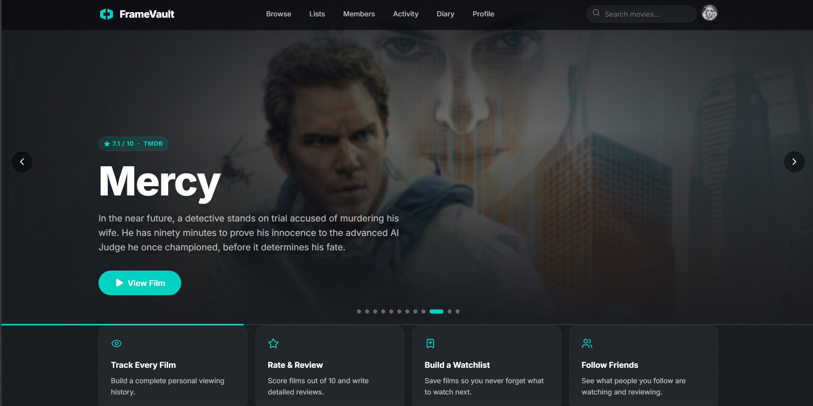
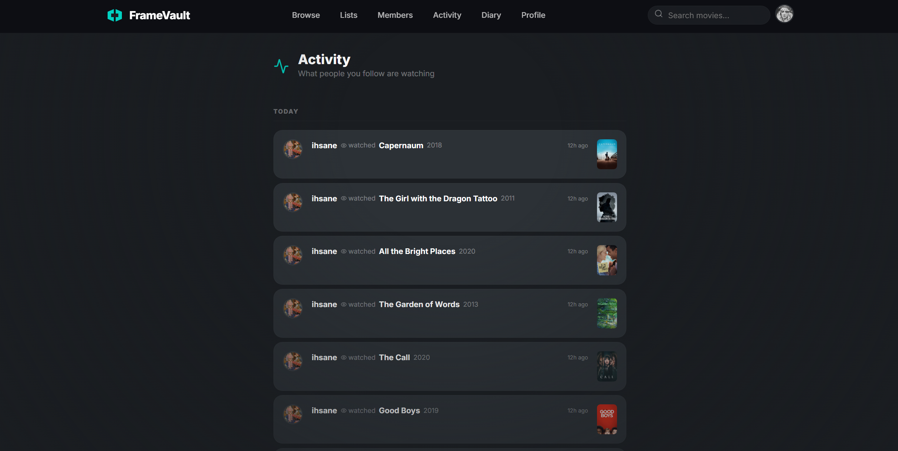

<div align="center">


# FrameVault

**A social film-tracking platform — discover, rate, review, and share every movie you watch.**

[](https://frame-vault-xi.vercel.app)
[](https://nextjs.org)
[](https://www.typescriptlang.org)
[](https://www.prisma.io)
[](https://supabase.com)

</div>

---

## Screenshots

<table>
  <tr>
    <td></td>
    <td></td>
  </tr>
  <tr>
    <td align="center"><em>Hero Carousel — trending films with backdrop</em></td>
    <td align="center"><em>"Picked For You" — genre-based personalized recs</em></td>
  </tr>
  <tr>
    <td></td>
    <td></td>
  </tr>
  <tr>
    <td align="center"><em>Trending This Week + And the Oscar Goes to…</em></td>
    <td align="center"><em>Profile — Top 5 Favorites + Ratings Histogram</em></td>
  </tr>
  <tr>
    <td></td>
    <td></td>
  </tr>
  <tr>
    <td align="center"><em>Films tab — full watched history with rating filters</em></td>
    <td align="center"><em>Reviews tab — all written reviews</em></td>
  </tr>
  <tr>
    <td></td>
    <td></td>
  </tr>
  <tr>
    <td align="center"><em>Diary — chronological film log by year/month</em></td>
    <td align="center"><em>Activity — what people you follow are watching</em></td>
  </tr>
  <tr>
    <td colspan="2"></td>
  </tr>
  <tr>
    <td colspan="2" align="center"><em>Members — discover and follow other film lovers</em></td>
  </tr>
</table>

---

## Features

### 🎬 Film Discovery
- **Hero Carousel** — rotating backdrop showcase of trending films
- **Personalized "Picked For You"** — genre-weighted recommendations based on your highest-rated movies (updates as you rate more)
- **Trending This Week** — live TMDB trending data
- **Top Rated All Time** — randomly sampled from TMDB's highest-rated films
- **Family-friendly filtering** — multi-layer adult content filter (TMDB flag + keyword/phrase blocklist)
- **Browse & Filter** — discover movies by genre, decade, sort order with URL-persisted state (back button works)
- **Actor Pages** — click any cast member to see their full filmography

### 👤 User Profiles
- **Top 5 Favorites** — pin your all-time favourites with custom poster support
- **Films tab** — paginated watched history with sort (Latest, Oldest, Top Rated, A–Z) and rating filters
- **Reviews tab** — all your written reviews in one place
- **Watchlist tab** — movies saved to watch later
- **Lists tab** — curated custom film lists
- **Network tab** — followers and following
- **Ratings histogram** — visual breakdown of all your ratings
- **Stats bar** — films, ratings, reviews, watchlist, followers, following, avg rating

### 📓 Diary
- Chronological film log grouped by year and month
- Navigate between years with prev/next arrows
- Shows star rating for each logged film

### 🎭 Social
- **Follow users** — see what friends are watching
- **Activity feed** — real-time stream of watches, ratings, and reviews from people you follow
- **Members page** — discover popular members, search by username, filter by newest or most films
- **Reviews** — write and read reviews with optional spoiler tags

### ⭐ Rating System
- Rate movies 1–10 (displayed as 0.5–5 stars)
- "Mark as watched?" prompt after rating
- Rating histogram per movie
- Friends' activity overlay on movie pages

### 🖼️ Custom Posters (Letterboxd-style)
- Upload your own poster or pick from TMDB alternatives
- Custom posters appear everywhere: profile, watchlist, activity feed, Top 5 Favorites

### 📋 Lists
- Create public or private curated film lists
- Add notes per film, reorder entries
- Browse community lists on the home page

---

## Tech Stack

| Layer | Technology |
|---|---|
| **Framework** | [Next.js 16](https://nextjs.org) (App Router, React 19) |
| **Language** | TypeScript |
| **Database** | PostgreSQL via [Supabase](https://supabase.com) |
| **ORM** | [Prisma 7](https://www.prisma.io) |
| **Auth** | [NextAuth.js v5](https://authjs.dev) (credentials + OAuth) |
| **Storage** | Supabase Storage (S3-compatible) for custom posters |
| **Movie Data** | [TMDB API](https://www.themoviedb.org/documentation/api) |
| **Rate Limiting** | [Upstash Redis](https://upstash.com) |
| **Icons** | [Lucide React](https://lucide.dev) |
| **Deployment** | [Vercel](https://vercel.com) |

---

## Getting Started

### Prerequisites
- Node.js 18+
- PostgreSQL database (or a free [Supabase](https://supabase.com) project)
- [TMDB API key](https://www.themoviedb.org/settings/api) (free)

### 1. Clone & install

```bash
git clone https://github.com/SPIN0ZAi/FrameVault.git
cd FrameVault
npm install
```

### 2. Environment variables

Create a `.env` file in the project root:

```env
# Database
DATABASE_URL="postgresql://..."

# NextAuth
NEXTAUTH_SECRET="your-secret-here"
NEXTAUTH_URL="http://localhost:3000"

# TMDB (use the Bearer token, not the API key)
TMDB_API_KEY="your-tmdb-bearer-token"

# Supabase Storage (for custom poster uploads)
NEXT_PUBLIC_SUPABASE_URL="https://your-project.supabase.co"
NEXT_PUBLIC_SUPABASE_ANON_KEY="your-anon-key"
SUPABASE_SERVICE_ROLE_KEY="your-service-role-key"

# Upstash Redis (optional — for rate limiting)
UPSTASH_REDIS_REST_URL="https://..."
UPSTASH_REDIS_REST_TOKEN="..."
```

### 3. Database setup

```bash
npx prisma migrate dev
npx prisma db seed   # optional: seed genres
```

### 4. Run development server

```bash
npm run dev
```

Open [http://localhost:3000](http://localhost:3000).

---

## Project Structure

```
src/
├── app/
│   ├── page.tsx              # Home page
│   ├── movies/               # Browse + movie detail pages
│   ├── actors/[id]/          # Actor filmography pages
│   ├── users/[username]/     # User profile pages
│   ├── diary/                # Film diary
│   ├── activity/             # Activity feed
│   ├── members/              # Members directory
│   ├── lists/                # Community lists
│   └── api/                  # All API routes
│       ├── movies/           # Movie CRUD, ratings, reviews, watched
│       ├── actors/[id]/      # Actor details + filmography
│       ├── users/            # User profiles, follow, watchlist
│       ├── recommendations/  # Personalized genre-based recs
│       ├── activity/         # Activity feed
│       └── auth/             # NextAuth routes
├── components/
│   ├── layout/               # Header, Footer
│   ├── providers/            # NextAuth + SWR providers
│   └── ui/                   # Reusable components
│       ├── HeroCarousel      # Home page hero
│       ├── PopularSection    # Live "Popular Right Now"
│       ├── PersonalizedRecs  # "Picked For You"
│       ├── ScrollRow         # Horizontal scroll container
│       └── ImageUploader     # Custom poster uploader
├── lib/
│   ├── tmdb.ts               # TMDB API client + adult content filter
│   ├── prisma.ts             # Prisma client singleton
│   ├── auth/                 # NextAuth config
│   └── sync-movie.ts         # TMDB → local DB sync utility
└── types/
    └── next-auth.d.ts        # Session type augmentation
prisma/
├── schema.prisma             # Database schema
├── seed.ts                   # Genre seed data
└── migrations/               # Migration history
```

---

## Deployment

The app is deployed on **Vercel** with auto-deploy on push to `main`.

```bash
# Production build (also runs prisma generate)
npm run build
```

All environment variables are configured in the Vercel dashboard.

---

## License

MIT — do whatever you want with it.

---

<div align="center">
  <sub>Built with ❤️ by <a href="https://github.com/SPIN0ZAi">SPIN0ZAi</a></sub>
</div>


## Getting Started

First, run the development server:

```bash
npm run dev
# or
yarn dev
# or
pnpm dev
# or
bun dev
```

Open [http://localhost:3000](http://localhost:3000) with your browser to see the result.

You can start editing the page by modifying `app/page.tsx`. The page auto-updates as you edit the file.

This project uses [`next/font`](https://nextjs.org/docs/app/building-your-application/optimizing/fonts) to automatically optimize and load [Geist](https://vercel.com/font), a new font family for Vercel.

## Learn More

To learn more about Next.js, take a look at the following resources:

- [Next.js Documentation](https://nextjs.org/docs) - learn about Next.js features and API.
- [Learn Next.js](https://nextjs.org/learn) - an interactive Next.js tutorial.

You can check out [the Next.js GitHub repository](https://github.com/vercel/next.js) - your feedback and contributions are welcome!

## Deploy on Vercel

The easiest way to deploy your Next.js app is to use the [Vercel Platform](https://vercel.com/new?utm_medium=default-template&filter=next.js&utm_source=create-next-app&utm_campaign=create-next-app-readme) from the creators of Next.js.

Check out our [Next.js deployment documentation](https://nextjs.org/docs/app/building-your-application/deploying) for more details.

---

## Letterboxd CSV Format Specification

> Researched from community parsers and open-source importers: [neodb-social/neodb](https://github.com/neodb-social/neodb), [fastfingertips/letterboxdpy](https://github.com/fastfingertips/letterboxdpy), [bbeesley/trakt-to-letterboxd](https://github.com/bbeesley/trakt-to-letterboxd), [ejach/tautulliToLetterboxd](https://github.com/ejach/tautulliToLetterboxd), [FOSS-Syndicate/Letterboxd-to-TMDB](https://github.com/FOSS-Syndicate/Letterboxd-to-TMDB). Official import docs: <https://letterboxd.com/about/importing-data/>

---

### Export Format

#### ZIP File

Letterboxd data exports are downloaded as a ZIP archive named:

```
letterboxd-{username}-{YYYY-MM-DD-HH-MM}-utc.zip
```

Obtained from **Settings → Data → Export Your Data** (`https://letterboxd.com/settings/data/`).

> ⚠️ Do **not** unzip before uploading to Letterboxd's import page.

The ZIP always contains these files (if the user has data for each):

```
diary.csv
ratings.csv
reviews.csv
watched.csv
watchlist.csv
lists/
  {list-name}.csv
  ...
```

All CSV files are **UTF-8 encoded**, **comma-delimited**, with a header row as the first line.

---

#### `diary.csv`

Every diary entry the user has logged, including rewatches.

| Column | Type | Example | Notes |
|--------|------|---------|-------|
| `Date` | date | `2024-03-15` | Date the diary entry was logged |
| `Name` | string | `Dune: Part Two` | Film title |
| `Year` | integer | `2024` | Release year |
| `Letterboxd URI` | string | `https://boxd.it/a9bC` | Short URL to the film on Letterboxd |
| `Rating` | float | `4.5` | Half-star rating 0.5–5.0; **empty** if not rated |
| `Rewatch` | string | `Yes` | `Yes` if it is a rewatch; **empty** otherwise |
| `Tags` | string | `favourites,sci-fi` | Comma-separated tags; **empty** if none |
| `Watched Date` | date | `2024-03-14` | Actual watch date (may differ from `Date`); **empty** if not set |

---

#### `ratings.csv`

Every film the user has rated (does not require a diary entry).

| Column | Type | Example | Notes |
|--------|------|---------|-------|
| `Date` | date | `2024-03-15` | Date the rating was given |
| `Name` | string | `Dune: Part Two` | Film title |
| `Year` | integer | `2024` | Release year |
| `Letterboxd URI` | string | `https://boxd.it/a9bC` | Short URL to the film on Letterboxd |
| `Rating` | float | `4.5` | Half-star rating 0.5–5.0 |

---

#### `reviews.csv`

Every film the user has written a review for.

| Column | Type | Example | Notes |
|--------|------|---------|-------|
| `Date` | date | `2024-03-15` | Date the review was logged |
| `Name` | string | `Dune: Part Two` | Film title |
| `Year` | integer | `2024` | Release year |
| `Letterboxd URI` | string | `https://boxd.it/a9bC` | Short URL to the film on Letterboxd |
| `Rating` | float | `4.5` | Half-star rating 0.5–5.0; **empty** if not rated |
| `Rewatch` | string | `Yes` | `Yes` if a rewatch; **empty** otherwise |
| `Spoiler` | string | `Yes` | `Yes` if marked as containing spoilers; **empty** otherwise |
| `Review` | string | `An epic sequel...` | Review text (plain text or basic Markdown) |
| `Watched Date` | date | `2024-03-14` | Actual watch date |
| `Tags` | string | `favourites,sci-fi` | Comma-separated tags; **empty** if none |

---

#### `watched.csv`

Every film the user has ever marked as watched.

| Column | Type | Example | Notes |
|--------|------|---------|-------|
| `Date` | date | `2024-03-15` | Date marked watched |
| `Name` | string | `Dune: Part Two` | Film title |
| `Year` | integer | `2024` | Release year |
| `Letterboxd URI` | string | `https://boxd.it/a9bC` | Short URL to the film on Letterboxd |

---

#### `watchlist.csv`

Every film currently on the user's watchlist.

| Column | Type | Example | Notes |
|--------|------|---------|-------|
| `Date` | date | `2024-03-15` | Date added to the watchlist |
| `Name` | string | `Dune: Part Two` | Film title |
| `Year` | integer | `2024` | Release year |
| `Letterboxd URI` | string | `https://boxd.it/a9bC` | Short URL to the film on Letterboxd |

---

#### `lists/{list-name}.csv`

One file per user list. The file has a **multi-line header block** before the data rows.

**File structure:**

```
Letterboxd list export v7,,,,
,,,,
{List Name},{Description},,,,
Position,Name,Year,URL,Description
1,Dune: Part Two,2024,https://boxd.it/a9bC,
2,Oppenheimer,2023,https://boxd.it/xyz1,Best film of 2023
```

| Line | Content |
|------|---------|
| 1 | `Letterboxd list export v7,,,,` (version header) |
| 2 | Blank |
| 3 | List name, list description |
| 4 | Column headers: `Position,Name,Year,URL,Description` |
| 5+ | Data rows |

**Data columns:**

| Column | Type | Example | Notes |
|--------|------|---------|-------|
| `Position` | integer | `1` | 1-based rank within the list |
| `Name` | string | `Dune: Part Two` | Film title |
| `Year` | integer | `2024` | Release year |
| `URL` | string | `https://boxd.it/a9bC` | Full Letterboxd URL to the film |
| `Description` | string | `Best film of 2024` | Per-item note; **empty** if none |

---

### Import Format

Letterboxd accepts CSV files uploaded at **`https://letterboxd.com/import/`**.

At least **one** of these four columns must be present to identify each film: `LetterboxdURI`, `tmdbID`, `imdbID`, or `Title`.

#### Supported Import Columns

| Column | Type | Required? | Example | Notes |
|--------|------|-----------|---------|-------|
| `LetterboxdURI` | string | one of 4 | `https://boxd.it/a9bC` | Most reliable identifier |
| `tmdbID` | integer | one of 4 | `693134` | TMDB movie ID |
| `imdbID` | string | one of 4 | `tt15239678` | IMDb ID (must start with `tt`) |
| `Title` | string | one of 4 | `Dune: Part Two` | Film title; combine with `Year` to disambiguate |
| `Year` | integer | no | `2024` | Release year |
| `Directors` | string | no | `Denis Villeneuve` | Director name(s) |
| `Rating` | float | no | `4.5` | Half-star scale: 0.5–5.0 in 0.5 increments |
| `Rating10` | integer | no | `9` | Integer scale: 1–10 (use `Rating` **or** `Rating10`, not both) |
| `WatchedDate` | date | no | `2024-03-14` | Format: `YYYY-MM-DD` |
| `Rewatch` | string | no | `Yes` | `Yes` to mark as a rewatch; empty otherwise |
| `Tags` | string | no | `favourites,sci-fi` | Comma-separated tag list |
| `Review` | string | no | `An epic sequel...` | Plain text review body |
| `Rank` | integer | no | `1` | Position in a list (used when importing lists) |

#### Minimal Import CSV Example

```csv
tmdbID,WatchedDate,Rating
693134,2024-03-14,4.5
```

#### Full Import CSV Example

```csv
LetterboxdURI,tmdbID,imdbID,Title,Year,Directors,Rating,Rating10,WatchedDate,Rewatch,Tags,Review
https://boxd.it/a9bC,693134,tt15239678,Dune: Part Two,2024,Denis Villeneuve,4.5,,2024-03-14,,favourites,A stunning sequel
,27205,tt1375666,Inception,2010,Christopher Nolan,,9,2023-11-20,Yes,rewatches,Still holds up
```

---

### Field Value Reference

| Field | Valid Values |
|-------|-------------|
| `Rating` (export & import) | `0.5` `1.0` `1.5` `2.0` `2.5` `3.0` `3.5` `4.0` `4.5` `5.0` |
| `Rating10` (import only) | `1` through `10` (integer) |
| `Date` / `WatchedDate` / `Watched Date` | `YYYY-MM-DD` — e.g. `2024-03-14` |
| `Rewatch` / `Spoiler` | `Yes` — leave cell **empty** for false |
| `Tags` | Comma-separated string — e.g. `"favourites,horror,2024"` |
| `imdbID` | `tt` followed by 7+ digits — e.g. `tt15239678` |
| `tmdbID` | Positive integer — e.g. `693134` |
| `LetterboxdURI` / `Letterboxd URI` | `https://boxd.it/{code}` |

---

### Export vs Import Column Name Differences

The export CSVs use **spaced human-readable names**; the import format uses **camelCase names**.

| Concept | Export column name | Import column name |
|---------|-------------------|-------------------|
| Film URL | `Letterboxd URI` | `LetterboxdURI` |
| Watch date | `Watched Date` | `WatchedDate` |
| Film title | `Name` | `Title` |
| Rating (float) | `Rating` | `Rating` |
| Rating (integer) | *(not present)* | `Rating10` |

---

### This Project's Import Endpoint

`POST /api/import/letterboxd` accepts a **single pre-parsed movie entry** as JSON (the front-end parses the CSV and sends one request per row):

```json
{
  "title": "Dune: Part Two",
  "year": 2024,
  "watched": true,
  "watchedDate": "2024-03-14",
  "rating": 9,
  "review": "A stunning sequel.",
  "watchlist": false
}
```

- `rating` must already be **converted** from Letterboxd's 0.5–5.0 float scale to the 1–10 integer scale (`rating * 2`).
- The endpoint resolves the film via TMDB search using `title` + `year`.
